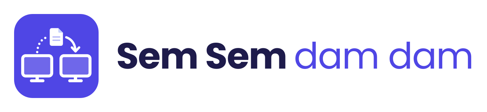
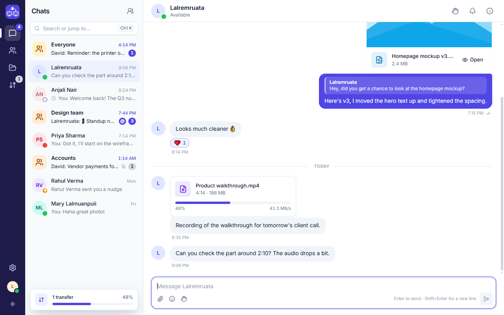
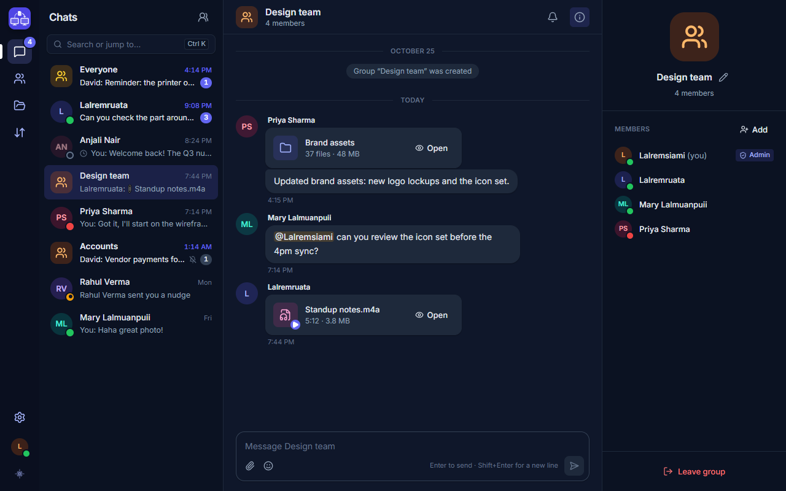

<picture>
  <source media="(prefers-color-scheme: dark)" srcset="docs/logo-dark.svg">
  
</picture>

### Chat and share files with everyone in your office. No internet needed.

**Your files never leave your office network.**

[**⬇ Download for Windows**](https://github.com/arsi-consultancy/semsemdamdam-releases/releases/latest) &nbsp;·&nbsp; macOS and Linux coming soon

 

 

## What is Sem Sem dam dam?

Sem Sem dam dam is a simple app for talking and sharing files with the people in your office.
Install it on each computer and colleagues appear on their own. There are no accounts to create,
nothing to set up, and nothing goes over the internet.

- 💬 **Chat** one-to-one, in groups, or with everyone at once
- 📎 **Send any file or folder**, big or small. Just drag it into a chat
- 🔒 **Lock files with a password** so only the right person can open them
- 👋 **Nudge** a colleague to get their attention
- 🟢 **See who's available**, busy, away or not to be disturbed
- 🔍 **Find anything**: search people, messages and files in one place
- 🌙 **Light and dark themes**, and it stays out of your way in the system tray

## Get started in 3 steps

1. **Download** the installer from the
   [latest release](https://github.com/arsi-consultancy/semsemdamdam-releases/releases/latest).
   On Windows, choose the file ending in **`.setup.exe`**.
2. **Install** it by double-clicking the file.
   If Windows shows *"Windows protected your PC"*, click **More info**, then **Run anyway**.
   This message appears because the installer isn't registered with Microsoft yet. It's safe.
3. **Open Sem Sem dam dam** and type your name. Colleagues on the same network appear
   automatically.

The app updates itself when a new version is ready, so you only install it once.

## Questions

<b>Do I need the internet?</b>

 
No. Everything happens inside your office network. The app works even when your internet is down.

<b>Are my files and messages private?</b>

 
Yes. Messages and files go straight from one computer to another inside your office and are
encrypted along the way. They are never uploaded to any server or cloud.

<b>Is it free?</b>

 
Yes, for everyday office use. Larger offices that share a lot of files can get a licence for
higher limits. Write to <a href="mailto:contact@arsi.in">contact@arsi.in</a>.

<b>I can't see my colleagues. What should I do?</b>

 
Check that both computers are connected to the same office network (the same Wi-Fi or the same
cable network). If your office has several separate networks, open <b>People</b>, click
<b>+</b> and enter the other computer's address. Your IT person can help with that.

<b>Which computers does it work on?</b>

 
Windows 10 and 11 today. Versions for macOS and Linux are on the way.

<b>How do I know my download is genuine?</b>

 
Download only from this page. Each release lists a <code>SHA256SUMS</code> file that IT staff can
use to check the files. Automatic updates are digitally signed and checked before they install.

 

---

<table>
<tr>
<td width="110" align="center">

</td>
<td>

### Made by Arsi Consultancy

**Making IT happen.** We build websites, mobile apps and custom software for businesses,
from Aizawl, Mizoram.

🌐 [www.arsi.in](https://www.arsi.in) &nbsp;·&nbsp; ✉️ [contact@arsi.in](mailto:contact@arsi.in)

Need help, a licence for your organisation, or software built for you? Get in touch. We'd be
happy to hear from you.

</td>
</tr>
</table>

© 2026 Arsi Consultancy. All rights reserved.

